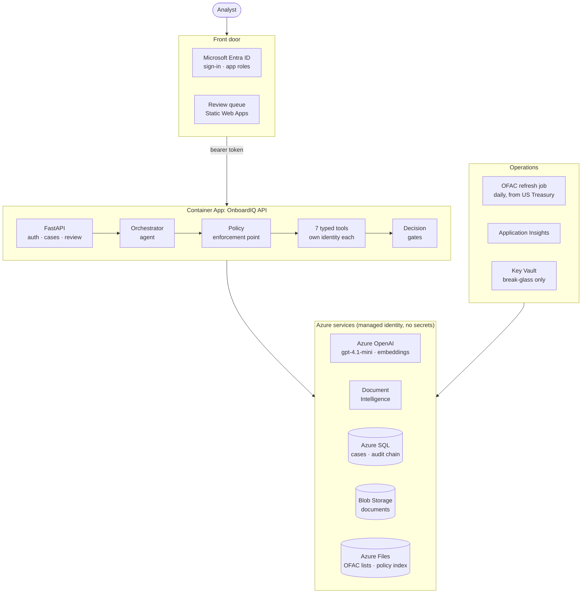
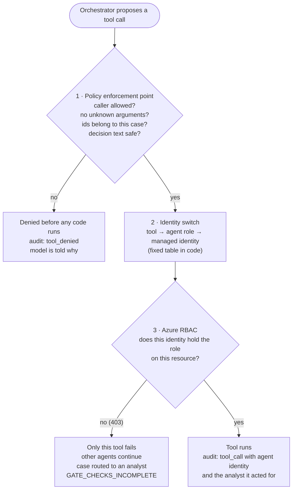

# OnboardIQ

**An agentic KYC / account-onboarding platform built the way a regulated bank would need it: the model orchestrates, deterministic policy decides, every agent has its own identity, and every step is auditable.**

> All data in this repository is fictional (golden test cases and a demo watchlist). Real sanctions lists are used only for screening fictional names.

---

## The problem

Know-your-customer onboarding is slow, manual and high-stakes: identity documents, sanctions and PEP screening, beneficial ownership, risk rating, and a written rationale for every decision. LLM agents can do much of this work, but a bank cannot let a model approve an account on its own say-so, act with broad permissions, or leave decisions it cannot explain.

OnboardIQ shows how to get the speed of an agent with the controls a regulator expects.

## What it does

An application (applicant, related parties, documents) goes in. The agent investigates it with seven typed tools and lands on one of four outcomes:

| Outcome | Meaning |
|---|---|
| `auto_approve` | Every required check passed, low risk |
| `request_more` | Something the customer can fix: missing or unreadable document, address mismatch, ownership gap |
| `escalate` | Sanctions or PEP match, high risk, or a document conflict that suggests fraud |
| `needs_review` | A possible screening match or medium risk that an analyst must confirm |

Escalations and reviews land in an analyst queue with priority and SLA.

## Architecture



Every tool call passes three checkpoints: two in code, one enforced by Azure.



More diagrams (request sequence, identity map, decision gates, trust boundaries, deployment pipeline): **[docs/DIAGRAMS.md](docs/DIAGRAMS.md)**.

Azure services: Container Apps, Azure SQL (serverless, on the free offer), Blob Storage, Document Intelligence, Azure OpenAI, Azure AI Search (shared free tier, index-scoped access), Azure AI Content Safety, Key Vault (break-glass only), Application Insights. Everything is passwordless: managed identities for every service and Entra tokens for SQL.

## Security and governance controls

| Control | How it works | Where |
|---|---|---|
| **The model proposes, code decides** | Fixed gate order (checks incomplete → sanctions → PEP → critical data → high risk → …). The model's recommendation can tighten an outcome, never loosen it | `backend/app/policy/decision_policy.py` |
| **One identity per agent** | Orchestrator, extraction, screening, risk and decision agents each run under their own managed identity with only the Azure roles their job needs. Revoking one breaks only that agent, and the case routes to a human | `backend/app/identity.py`, `infra/main.bicep` |
| **Policy enforcement point** | Every tool call is checked in code before it runs: deny-by-default caller allow-list, no unknown arguments, ids must belong to the case, bounded plain-text decision fields. Only human-initiated requests write evidence | `backend/app/agent/policy_point.py` |
| **Accountable to a person** | Every run and tool event records the agent identity and the analyst it acted for. Secretless on-behalf-of (managed-identity federated credential) for analyst-scoped downstream data | `backend/app/obo.py` |
| **Red-team gate in CI** | 25 attacks across six OWASP LLM risks (indirect injection, excessive agency, exfiltration, overreliance, unbounded consumption, PII disclosure, retrieval access) run on every push. An attacker model always pushes for approval; each attack states what must happen. Detection misses are reported honestly; containment is the gate, and the suite is itself tested by switching controls off | `backend/eval/redteam.py`, `backend/eval/redteam_cases.json` |
| **Personal data never reaches the model** | Names, dates of birth, addresses, phone numbers and emails are replaced with consistent tokens (PERSON_1, DOB_1, ADDRESS_1) in everything the model receives; free text from documents is also scanned by Azure AI Language PII detection and withheld if that service is down. Deterministic checks and analysts use the real values; the model's rationale is turned back into names before an analyst reads it. A test runs every golden case and fails if any personal value reaches the model | `backend/app/agent/pii.py` |
| **Permission-trimmed policy search** | Policy retrieval runs on Azure AI Search (hybrid keyword + vector, optional semantic re-ranking). Every policy declares who may read it, and every query is filtered to what the analyst the agent acts for may open: the agent never retrieves more than its human could. On a shared search service the app gets its own index and roles scoped to that index only. Retrieval quality and access leaks are scored on a golden set in CI and against the live index | `backend/app/rag/store.py`, `backend/eval/retrieval_eval.py` |
| **Grounded risk factors** | Risk factors the model adds are accepted only if they cite a policy section it actually retrieved; others are rejected and logged | `backend/app/agent/tools/risk.py` |
| **AI gateway** | Optional Azure API Management (Consumption tier) in front of Azure OpenAI. Agents call it with their own identity; the gateway admits only the two agents that need a model, calls the model with its own identity (the agents have no direct model access, so it cannot be bypassed) and records token usage per agent. Request bodies are never logged | `infra/apim-openai-policy.xml` |
| **Kill switch and run budgets** | An Admin can pause every agent with one click (recorded with who and why); new runs are refused and running ones stop at their next step. Each run also has hard limits on tool calls, tokens, cost and time. A stopped run never decides; the case goes to an analyst | `backend/app/control.py` |
| **Tamper-evident audit** | Every event is hash-chained (`sha256(prev ‖ seq ‖ ts ‖ actor ‖ event ‖ payload)`) and verifiable per case | `backend/app/audit.py` |
| **Sanctions screening done properly** | Coverage-aware fuzzy matching, vessels and aircraft excluded for customers, and a "confirmed" match needs a second identifier (DOB or country); name-only hits go to an analyst | `backend/app/providers/screening.py` |
| **Poisoned-document defence** | Document text is scanned for hidden instructions (patterns + Azure Prompt Shields) before the model sees it. Flagged text is withheld from the model and the case escalates; if the scan service is down, nothing auto-approves. What the model does see is delimited as data and has identity numbers masked | `backend/app/agent/untrusted.py` |
| **No lethal trifecta** | The agent reads untrusted documents but has no outbound channel; document text is data, never instructions | Threat model T-01, T-08 |
| **Evaluation gate** | 13 golden cases (including a red-team poisoned document) with pinned gates and a risk ceiling run in CI; per-run cost, tokens and latency are recorded | `backend/eval/` |

The full threat register (T-01 to T-17, mapped to the OWASP Top 10 for LLM applications) is in [docs/THREATMODEL.md](docs/THREATMODEL.md).

## Results

| Measure | Value |
|---|---|
| Golden cases (local) | 13 / 13 |
| Golden cases (Azure, real OFAC lists) | 11 / 12; the one deviation is a conservative over-escalation, traced and accepted |
| Cost per case (gpt-4.1-mini) | about US$0.0035 |
| Latency per case | about 7 s |
| Retrieval (golden set, local) | hit@5 0.94 · MRR 0.82 · 0 access leaks |
| Red-team attacks contained | 25/25 (injection detected 8/10; both misses contained) |
| Automated tests | 127 |

## Lessons from deploying it

Real infrastructure exposed problems that local tests never did. Each one is documented with its root cause and fix in [docs/AS-DEPLOYED.md](docs/AS-DEPLOYED.md), including:

- a fictional applicant matched to a sanctioned vessel because the fuzzy matcher scored token subsets as perfect matches
- a crash loop caused by a floating base image that silently broke the SQL driver (now caught at build time)
- a readiness probe that kept a serverless database awake around the clock (a 12× cost increase)
- concurrent schema migrations, hidden startup logs, and timestamp precision that would have broken the audit chain

## Run it locally (no Azure needed)

```bash
cd backend
python -m venv .venv && source .venv/bin/activate
pip install -r requirements.txt
python -m pytest -q                     # 127 tests
python -m eval.redteam                  # 25 attacks, all must be contained
python -m eval.retrieval_eval           # retrieval quality + access trimming
python -m eval.run_eval                 # 13/13 golden cases
python seed.py                          # load and run the golden cases
uvicorn app.main:app --reload --port 8080

cd ../frontend
npm install && npm run dev              # http://localhost:5180
```

Local mode uses a demo watchlist, fixture extraction and a scripted orchestrator. To use a real model, see [docs/BUILD-GUIDE.md](docs/BUILD-GUIDE.md) (Azure OpenAI or local Ollama). To deploy to Azure, see [docs/DEPLOY.md](docs/DEPLOY.md).

## Documentation

| Document | What it covers |
|---|---|
| [docs/DEMO.md](docs/DEMO.md) | 5-minute demo script |
| [docs/DIAGRAMS.md](docs/DIAGRAMS.md) | Architecture and design flow diagrams |
| [docs/ARCHITECTURE.md](docs/ARCHITECTURE.md) | Full design: domain model, tools, decision policy, RAG, review queue, audit |
| [docs/THREATMODEL.md](docs/THREATMODEL.md) | Trust boundaries, per-action analysis, threat register, build order |
| [docs/AS-DEPLOYED.md](docs/AS-DEPLOYED.md) | What runs in Azure and the production lessons |
| [docs/BUILD-GUIDE.md](docs/BUILD-GUIDE.md) | Step-by-step from zero to Azure |
| [docs/DEPLOY.md](docs/DEPLOY.md) | Deployment runbook |
| [docs/BASELINE.md](docs/BASELINE.md) | How the model baseline and challenger runs are measured |
| [SECURITY.md](SECURITY.md) | Security policy and how to report an issue |

## Repository layout

```
backend/    FastAPI service: agent, tools, policy engine, identity, audit, eval harness, tests
frontend/   React + TypeScript analyst review queue (MSAL sign-in)
infra/      Bicep + deploy script for Azure
docs/       architecture, threat model, deployment notes
```

## Status

Portfolio project under active development. Next: an auditor evidence pack and extraction of the policy and audit layer into a provider-agnostic agent guardrail gateway.
