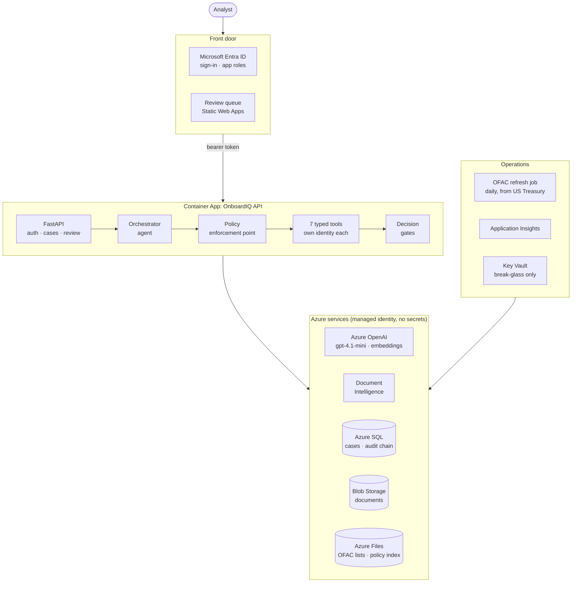
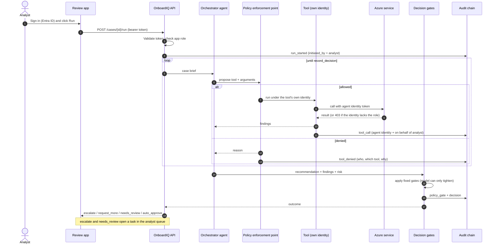
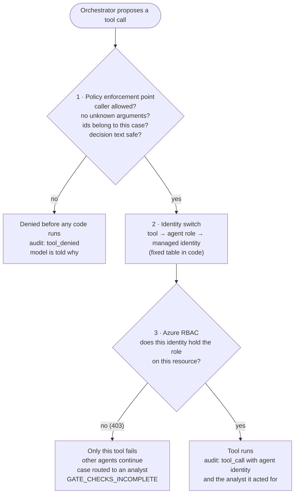
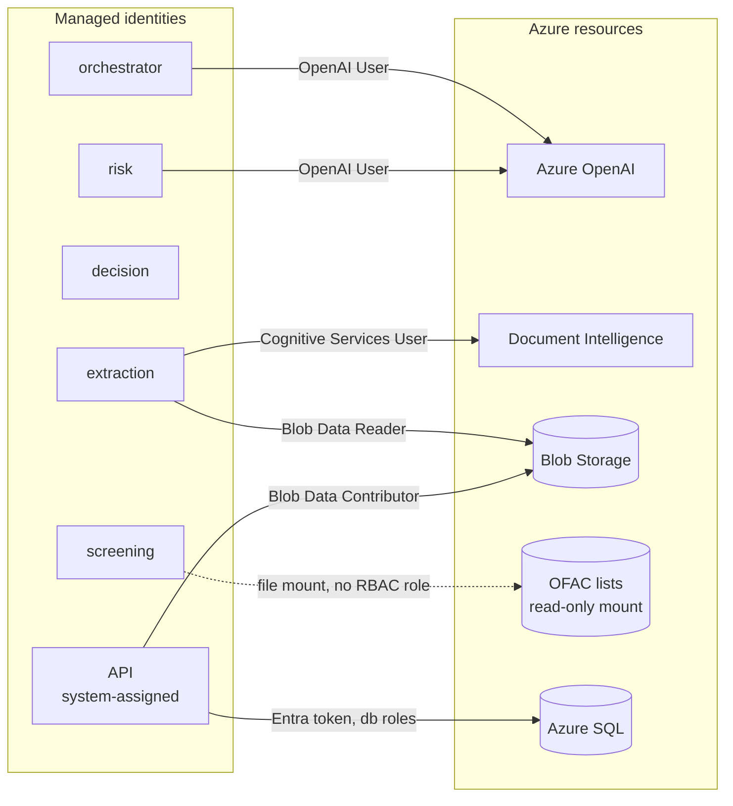
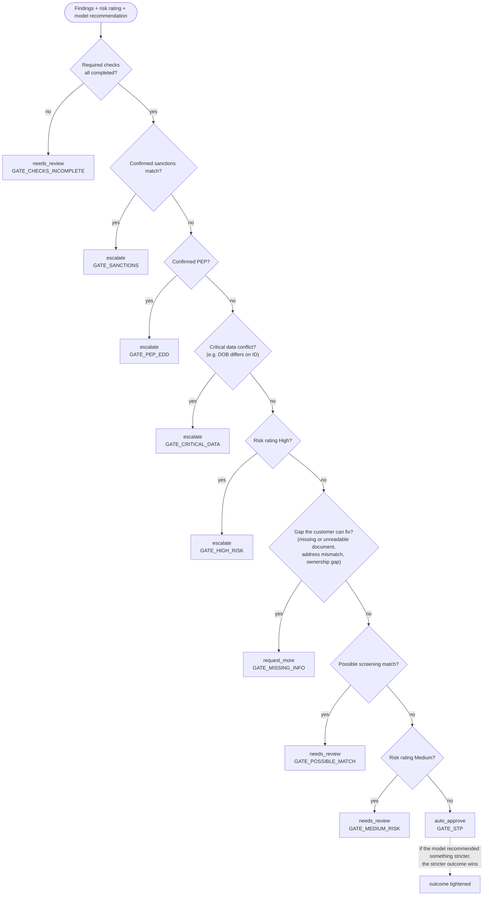
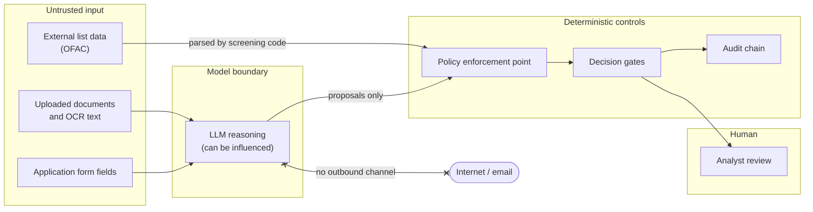
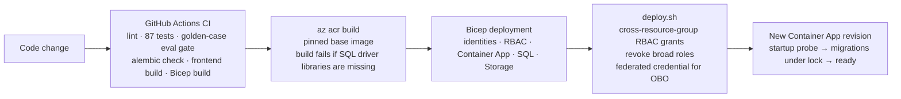

# OnboardIQ — architecture and design diagrams

GitHub renders these Mermaid diagrams directly. Each one answers one question.

1. [System architecture](#1-system-architecture) — what runs where
2. [Processing one case](#2-processing-one-case) — the request flow, step by step
3. [Three checkpoints on every tool call](#3-three-checkpoints-on-every-tool-call) — how an agent action is authorized
4. [Agent identities and Azure access](#4-agent-identities-and-azure-access) — least privilege per agent
5. [Decision gates](#5-decision-gates) — how the outcome is decided
6. [Trust boundaries](#6-trust-boundaries) — where untrusted input enters
7. [Deployment pipeline](#7-deployment-pipeline) — how code reaches Azure

---

## 1. System architecture

All service-to-service calls use managed identities. Azure SQL is reached with an Entra access token. No secrets in configuration.

---

## 2. Processing one case

---

## 3. Three checkpoints on every tool call

The first two checkpoints are code; the third is enforced by Azure, so even a bug in the code cannot exceed an identity's roles.

---

## 4. Agent identities and Azure access

| Agent | Tools | Azure access | May call other tools |
|---|---|---|---|
| orchestrator | planning loop, consistency, address, ownership | Azure OpenAI | yes (only role allowed) |
| extraction | extract_document | Document Intelligence, Blob read | no |
| screening | screen_parties | none (read-only file mount) | no |
| risk | rate_risk, policy search | Azure OpenAI | no |
| decision | record_decision | none | no |
| API | HTTP, uploads | SQL, Blob read/write | no |

---

## 5. Decision gates

Gates are evaluated in this fixed order. The model's recommendation can only move an outcome toward a stricter one, never looser.

---

## 6. Trust boundaries

Untrusted text can influence what the model proposes, but every proposal crosses deterministic code before anything happens, and the agent has no outbound channel (the "lethal trifecta" is broken by design). Full analysis: [THREATMODEL.md](THREATMODEL.md).

---

## 7. Deployment pipeline

